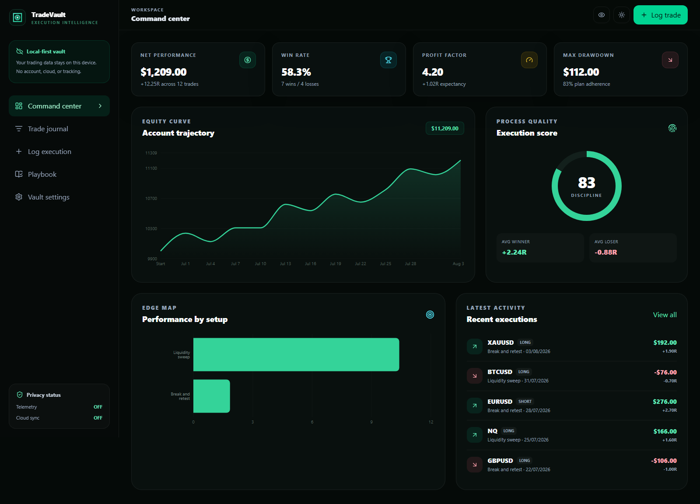

<div align="center">
  
  <h1>TradeVault</h1>
  <p><strong>Turn every execution into evidence.</strong></p>
  <p>A private, local-first trading journal and manual backtesting workspace for disciplined traders.</p>

[](https://github.com/MrBoodj011/TradeVault/actions/workflows/ci.yml)
[](https://github.com/MrBoodj011/TradeVault/actions/workflows/security.yml)
[](LICENSE)
[](docs/ARCHITECTURE.md)
</div>



## Why TradeVault

Most journals count wins and losses. TradeVault connects performance with execution quality: setup, session, direction, risk, confidence, emotion, mistakes, plan adherence, notes, and evidence. The result is a workspace that helps answer the questions that matter:

- Which setups have a measurable edge?
- Is the strategy failing, or is execution drifting?
- What is the real expectancy and drawdown profile?
- Which sessions, markets, and behaviors should be removed?

TradeVault runs without an account, analytics SDK, advertising, or mandatory cloud service. Your data stays in the browser's IndexedDB database unless you explicitly export it.

## Product capabilities

| Area              | What is included                                                                                                                   |
| ----------------- | ---------------------------------------------------------------------------------------------------------------------------------- |
| Command center    | Net PnL, net R, win rate, expectancy, profit factor, drawdown, plan adherence, equity curve, streaks, and setup performance        |
| Trade journal     | Searchable and filterable execution ledger with edit, delete, notes, tags, screenshots, emotion, confidence, fees, and R-multiples |
| Execution capture | Structured trade logging for Forex, Crypto, Stocks, Futures, and Options                                                           |
| Playbook          | Reusable setup definitions, entry checklists, and performance linked directly to each setup                                        |
| Risk controls     | Account balance, per-trade risk limit, daily loss limit, fees, and drawdown measurement                                            |
| Portable data     | Full JSON backups plus spreadsheet-safe CSV import and export                                                                      |
| Private vault     | Optional AES-256-GCM encryption with PBKDF2-SHA256 key derivation                                                                  |
| Offline use       | Installable PWA with a service worker and no required backend                                                                      |
| Deployment        | NPM development workflow and hardened, non-root Docker image                                                                       |

## Quick start with NPM

Requirements: Node.js 22 or newer and NPM 10 or newer.

```bash
git clone https://github.com/MrBoodj011/TradeVault.git
cd TradeVault
npm ci
npm run dev
```

Open [http://localhost:3000](http://localhost:3000). Load the demo workspace from **Vault settings** or start with your first trade.

Production build:

```bash
npm run check
npm run start
```

## Run with Docker

```bash
docker compose up --build -d
```

Open [http://localhost:3001](http://localhost:3001). The compose file binds to `127.0.0.1` by default, drops Linux capabilities, uses a read-only filesystem, and runs as a non-root user.

Published releases can also run from GHCR:

```bash
docker pull ghcr.io/mrboodj011/tradevault:1.0.0
docker run --rm -p 127.0.0.1:3001:3000 ghcr.io/mrboodj011/tradevault:1.0.0
```

## Privacy and security model

TradeVault is local-first, but browser storage is not a substitute for a secure operating system. Enable vault encryption when the device is shared, use a strong unique passphrase, and keep an offline backup. A forgotten passphrase cannot be recovered.

Imports are size-limited and schema-validated. CSV exports neutralize spreadsheet formula prefixes. Production responses include restrictive security headers, and CI runs dependency review, CodeQL, Gitleaks, unit tests, browser tests, accessibility checks, and a container build.

Read the [architecture](docs/ARCHITECTURE.md), [threat model](docs/THREAT_MODEL.md), and [security policy](SECURITY.md) before exposing a modified build to a network.

## Development

```bash
npm run lint
npm run typecheck
npm test
npm run test:e2e
npm run build
```

The application is built with Next.js, React, TypeScript, Tailwind CSS, IndexedDB, Zod, Recharts, Vitest, Playwright, and axe-core.

## Project status

Version `1.0.0` is the first stable local-first release. See the [roadmap](ROADMAP.md) for broker-neutral import adapters, richer backtesting workflows, and optional end-to-end encrypted sync.

## Contributing

Issues, discussions, and focused pull requests are welcome. Read [CONTRIBUTING.md](CONTRIBUTING.md), the [Code of Conduct](CODE_OF_CONDUCT.md), and [SECURITY.md](SECURITY.md) first.

## Author

TradeVault is designed and maintained by [MrBoodj011](https://github.com/MrBoodj011).

## License and disclaimer

Released under the [GNU Affero General Public License v3.0](LICENSE). TradeVault is research and journaling software, not financial advice, a broker, or an order-execution system. Trading involves substantial risk.
